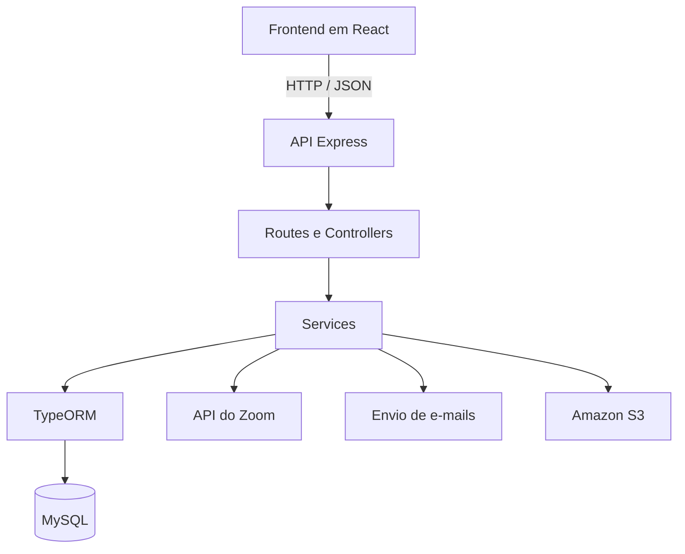

<a id="topo"></a>

<p align="center">
  <a href="#sobre-o-projeto">Sobre o projeto</a> •
  <a href="#funcionalidades">Funcionalidades</a> •
  <a href="#tecnologias">Tecnologias</a> •
  <a href="#arquitetura">Arquitetura</a> •
  <a href="#rotas-da-api">Rotas da API</a> •
  <a href="#executando-o-projeto">Como executar</a> •
  <a href="#equipe-e-repositorios">Equipe e repositórios</a>
</p>

<div align="center">

# 📅 SIATT — API de Gerenciamento de Reuniões

### Backend do projeto desenvolvido pelo MirageGroup no 4º semestre de Análise e Desenvolvimento de Sistemas — FATEC São José dos Campos (2024)

API REST para organização de reuniões presenciais, remotas e híbridas, com gerenciamento de salas, participantes, convites e integração com serviços externos.

<br>


<br><br>

**[📚 Projeto e documentação geral](https://github.com/MirageGroup/API_MirageGroup_4sem)** · **[🖥️ Frontend em React](https://github.com/MirageGroup/api_miragegroup_4sem_front)** · **[⚙️ Backend original](https://github.com/MirageGroup/API_MirageGroup_4sem_back)**

</div>

> **Sobre este repositório:** este é meu *fork* pessoal do backend de um projeto acadêmico desenvolvido **em equipe** pelo MirageGroup, em parceria com a SIATT. A documentação completa das entregas, dos integrantes e dos requisitos está no [repositório principal](https://github.com/MirageGroup/API_MirageGroup_4sem).

---

<a id="sobre-o-projeto"></a>

<h2 align="center">🎯 Sobre o projeto</h2>

O projeto surgiu de um desafio apresentado pela **SIATT**, empresa parceira da FATEC São José dos Campos. O objetivo era desenvolver uma plataforma para centralizar e facilitar o **agendamento e a organização de reuniões** entre diferentes equipes, considerando disponibilidade de salas, quantidade de participantes, diferentes níveis de acesso e modalidades presencial, remota ou híbrida.

Este repositório contém o **backend** da aplicação: uma API REST em **Node.js, TypeScript e Express**, responsável por gerenciar os dados de usuários, salas e reuniões, aplicar regras de disponibilidade e integrar a plataforma a serviços como Zoom, e-mail e Amazon S3.

<div align="center">
  <h3>🏢 Empresa parceira</h3>
  
  <p>SIATT — Engenharia, Indústria e Comércio</p>
</div>

<p align="right"><a href="#topo">↑ Voltar ao topo</a></p>

---

<a id="funcionalidades"></a>

<h2 align="center">🧩 Funcionalidades do backend</h2>

| Módulo | Recursos implementados |
| :-- | :-- |
| **Usuários e autenticação** | Cadastro, login, perfis, armazenamento de senhas com bcrypt e autenticação JWT em rotas selecionadas. |
| **Salas físicas** | Cadastro, consulta e atualização de salas, com localização, capacidade e nível de acesso. |
| **Salas virtuais** | Cadastro e gerenciamento de salas virtuais e seus respectivos níveis de acesso. |
| **Verificação de disponibilidade** | Consulta de salas considerando o horário da reunião, possíveis conflitos e permissões; para salas físicas, também considera a capacidade. |
| **Reuniões** | Cadastro, consulta, atualização e exclusão de reuniões presenciais, virtuais e híbridas, com associação de participantes. |
| **Convites e avisos** | Envio de e-mails para participantes e convidados durante a criação ou atualização de reuniões. |
| **Integração com Zoom** | Fluxo de autorização OAuth e criação de reuniões remotas usando a API do Zoom. |
| **Atas de reunião** | Upload de arquivos para um bucket Amazon S3, com associação do endereço do arquivo à reunião. |

O backend também permite consultar reuniões vinculadas ao usuário autenticado e trabalhar com diferentes tipos de salas em uma mesma estrutura de agendamentos.

<p align="right"><a href="#topo">↑ Voltar ao topo</a></p>

---

<a id="tecnologias"></a>

<h2 align="center">🛠️ Tecnologias utilizadas</h2>

| Categoria | Tecnologias |
| :-- | :-- |
| **Linguagem e execução** | TypeScript, Node.js |
| **API HTTP** | Express.js |
| **Banco de dados** | MySQL, TypeORM |
| **Autenticação** | JSON Web Token (JWT), bcrypt |
| **Integrações** | Axios, Zoom REST API / OAuth, Nodemailer |
| **Arquivos e nuvem** | Amazon S3, AWS SDK, Multer |
| **Desenvolvimento** | Nodemon, ts-node, migrations do TypeORM |

O frontend da plataforma foi desenvolvido separadamente, utilizando **React**. Seu código está disponível no [repositório do frontend](https://github.com/MirageGroup/api_miragegroup_4sem_front).

<p align="right"><a href="#topo">↑ Voltar ao topo</a></p>

---

<a id="arquitetura"></a>

<h2 align="center">🏗️ Arquitetura do backend</h2>

A API organiza o código em camadas, separando a definição de rotas, o tratamento das requisições, a lógica de negócio e o acesso a dados. O **Express** expõe os endpoints HTTP; os **controllers** recebem as requisições; os **services** concentram as operações e regras de negócio; e o **TypeORM** realiza a persistência no MySQL.



### 📁 Estrutura de diretórios

```text
src/
├── controllers/           # Tratamento de requisições e respostas HTTP
├── routes/                # Endpoints de usuários, salas e reuniões
├── services/              # Regras de negócio, persistência e integrações
├── infra/
│   ├── data-source.ts     # Configuração de conexão com o banco
│   ├── entities/          # Entidades e relacionamentos do TypeORM
│   └── migrations/        # Migrações do banco de dados
├── middlewares/           # Middleware de autenticação JWT
├── Data/                  # Utilitários e modelos de mensagens de e-mail
└── index.ts               # Inicialização do servidor Express
```

### 📊 Modelo de dados

As principais entidades do sistema são:

- **User:** usuários, credenciais, papéis e níveis de acesso;
- **PhysicalRoom:** salas físicas, localização, lotação e permissão necessária;
- **VirtualRoom:** salas virtuais e seus dados de acesso;
- **Meeting:** reuniões, horários, modalidade, participantes, convidados e vínculos com salas.

O relacionamento entre usuários e reuniões permite associar **múltiplos participantes** a um agendamento. Uma reunião também pode estar associada a uma sala física, virtual ou a ambas, conforme sua modalidade.

<p align="right"><a href="#topo">↑ Voltar ao topo</a></p>

---

<a id="rotas-da-api"></a>

<h2 align="center">🔗 Rotas da API</h2>

As rotas abaixo são alguns dos endpoints implementados no projeto. Para conferir os parâmetros e corpos das requisições, consulte os arquivos em [`src/routes/`](./src/routes) e [`src/controllers/`](./src/controllers).

### 👤 Usuários

| Método | Rota | Descrição |
| :--: | :-- | :-- |
| `POST` | `/user/create` | Cadastrar usuário |
| `POST` | `/user/login` | Autenticar usuário e gerar JWT |
| `GET` | `/user/fetchall` | Listar usuários |
| `GET` | `/user/getprofile` | Consultar perfil autenticado |
| `PATCH` | `/user/update` | Atualizar usuário autenticado |

### 🏢 Salas

| Método | Rota | Descrição |
| :--: | :-- | :-- |
| `POST` | `/physicalRoom/create` | Cadastrar sala física |
| `GET` | `/physicalRoom/get` | Listar salas físicas |
| `POST` | `/physicalRoom/checkAvailability` | Consultar disponibilidade de salas físicas |
| `POST` | `/virtualRoom/create` | Cadastrar sala virtual |
| `GET` | `/virtualRoom/get` | Listar salas virtuais |
| `POST` | `/virtualRoom/checkAvailability` | Consultar disponibilidade de salas virtuais |

### 📅 Reuniões e integrações

| Método | Rota | Descrição |
| :--: | :-- | :-- |
| `POST` | `/meeting/create` | Agendar reunião e disparar convites |
| `GET` | `/meeting/get` | Listar reuniões |
| `GET` | `/meeting/get/:id` | Consultar reunião pelo ID |
| `GET` | `/meeting/fetch` | Listar reuniões do usuário autenticado |
| `PATCH` | `/meeting/update/:id` | Atualizar reunião |
| `DELETE` | `/meeting/delete` | Excluir reunião |
| `GET` | `/meeting/authorize` | Iniciar autorização OAuth do Zoom |
| `GET` | `/meeting/callback` | Receber retorno da autenticação Zoom |
| `POST` | `/meeting/create-meeting` | Criar reunião pela API do Zoom |
| `POST` | `/meeting/:meeting_id/uploadata` | Enviar arquivo de ata para o S3 (campo `file`) |

> **Atenção:** a versão acadêmica utiliza middleware JWT **apenas em determinadas rotas**. Nem todos os endpoints estão protegidos. As rotas que exigem autenticação recebem o token no cabeçalho `Authorization: Bearer <token>`.

<p align="right"><a href="#topo">↑ Voltar ao topo</a></p>

---

<a id="executando-o-projeto"></a>

<h2 align="center">🚀 Executando o projeto localmente</h2>

### Pré-requisitos

- Node.js e npm instalados;
- Servidor MySQL disponível e banco de dados criado;
- Credenciais das integrações externas, caso queira testar Zoom, envio de e-mails ou upload no S3.

### 1. Clonar o repositório e instalar dependências

```bash
git clone https://github.com/pedro11pucci/API_MirageGroup_4sem_back.git
cd API_MirageGroup_4sem_back
npm install
```

### 2. Configurar as variáveis de ambiente

Crie o arquivo `.env` a partir do modelo existente no repositório:

```bash
cp .env.sample .env
```

Exemplo dos campos necessários:

```dotenv
PORT=8080

DB_TYPE=mysql
DB_HOST=localhost
DB_PORT=3306
DB_USERNAME=seu_usuario
DB_PASSWORD=sua_senha
DB_NAME=nome_do_banco

AWS_REGION=sua_regiao
AWS_ACCESS_KEY_ID=sua_access_key
AWS_SECRET_ACCESS_KEY=sua_secret_key
AWS_S3_BUCKET_NAME=nome_do_bucket

CLI_ID=seu_zoom_client_id
CLI_CODEBASE64=valor_de_autorizacao_zoom

SECRET_KEY=chave_secreta_do_jwt

TRANSPORTER_EMAIL=seu_email
TRANSPORTER_PASSWORD=senha_do_email
```

> **Segurança:** substitua os valores de exemplo pelas suas credenciais e nunca envie o arquivo `.env` para o GitHub. Ele já está incluído no `.gitignore`.

### 3. Iniciar o servidor

```bash
npm run dev
```

Depois da inicialização do banco de dados, com `PORT=8080`, a API ficará disponível em:

```text
http://localhost:8080
```

Para conferir a rota principal:

```bash
curl http://localhost:8080/
```

Resposta definida no código:

```text
Hello World!
```

### 4. Executar o frontend (opcional)

O frontend está em um [repositório separado](https://github.com/MirageGroup/api_miragegroup_4sem_front) e possui suas próprias dependências. O backend está configurado para aceitar requisições do endereço `http://localhost:3000` durante o desenvolvimento.

### ⚠️ Observações sobre o ambiente

- **Zoom:** o fluxo OAuth usa endereços locais (`localhost:8080` e `localhost:3000`) e depende de um aplicativo Zoom configurado corretamente.
- **E-mail:** as notificações usam Nodemailer, com transporte configurado para Hotmail no código original.
- **AWS S3:** o envio de atas requer bucket existente e permissões AWS adequadas.
- **TypeORM:** a configuração atual usa `synchronize: true` e também executa migrações na inicialização. Isso deve ser revisado antes de qualquer uso em produção.
- **Testes:** o script `npm test` do repositório é apenas um *placeholder*; não há suíte de testes automatizados configurada.

**Este README documenta o código disponível**, mas as integrações externas e a execução completa do ambiente não foram testadas novamente durante a atualização da documentação. Dependendo do ambiente, os aliases de importação TypeScript podem exigir configuração adicional.

<p align="right"><a href="#topo">↑ Voltar ao topo</a></p>

---

<a id="equipe-e-repositorios"></a>

<h2 align="center">👥 Equipe e repositórios</h2>

O sistema foi desenvolvido colaborativamente pelo **MirageGroup**, como projeto do 4º semestre de ADS da **FATEC São José dos Campos**, em 2024. A documentação do projeto principal contém os requisitos, o planejamento, as entregas das sprints e a relação completa de integrantes da equipe.

| Repositório | Conteúdo |
| :-- | :-- |
| [📚 Projeto principal — MirageGroup](https://github.com/MirageGroup/API_MirageGroup_4sem) | Visão geral, documentação, planejamento e equipe |
| [⚙️ Backend original](https://github.com/MirageGroup/API_MirageGroup_4sem_back) | API REST e desenvolvimento colaborativo do backend |
| [🖥️ Frontend](https://github.com/MirageGroup/api_miragegroup_4sem_front) | Interface web em React |
| [👤 Meu fork do backend](https://github.com/pedro11pucci/API_MirageGroup_4sem_back) | Cópia do backend para apresentação no portfólio |

<div align="center">

**Projeto de Aprendizagem por Projetos (API) — FATEC São José dos Campos · MirageGroup · 2024**

<a href="#topo">↑ Voltar ao topo</a>

</div>
